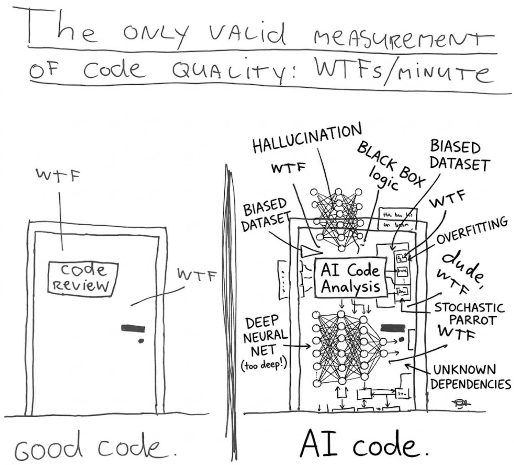

<div align="center">



# clean-n-code

### Actual Clean code skills for Claude Code.

**Based on actual literature about clean code, written by engineers and for engineers.**

clean-n-code decides **how code reads**: intent-revealing names, flat functions, and reviews that cite the heuristic behind each finding and tries to make the best decisions when it comes to the logic behind the idea.

[Quick Start](#quick-start) | [Skills](#what-you-can-do) | [How It Works](#how-it-works) | [Testing](#testing)

[](https://docs.claude.com/en/docs/claude-code)
[](https://nodejs.org)
[](#testing)
[-555555?style=for-the-badge)](knowledge.md)

**MIT** | Claude Code plugin | Skills + SessionStart hook

</div>

---

> **clean-n-code** turns Robert C. Martin's *Clean Code* into skills an agent follows while it works. It is backed by primary sources on cyclomatic and cognitive complexity (NIST/McCabe, SonarSource), module design (Parnas), architecture, dependencies and algorithms. Every rule carries a short code (`G5`, `N7`, `K3`, `D12`), so reviews cite the heuristic behind each finding, the way the book does.

> We believe that actual literature can help agents improve their reasoning, specially when inside their context and rules.
---

## What is clean-n-code?

clean-n-code is a **Claude Code plugin**: one always-on mode plus four slash-command skills.

- **Always-on mode** writes readable code while the agent works: intent-revealing names, functions at one level of abstraction, cyclomatic complexity of 10 or less, nesting of 2 or less, errors with context, F.I.R.S.T. tests.
- **Review, audit, and refactor skills** measure complexity, cite rule codes, and keep fixes inside the existing task scope. Readability is achieved inside the scope, never by adding scope.

```text
/clean-review          # readability/design review of your current change
/clean-audit           # the same for a whole repo, ranked
/clean-refactor        # fix findings without changing behavior
```

---

## Preview

The output below is a real `/clean-review` finding from the eval suite.

```text
3. Arrow code: 6 levels of nesting (orders.py:L3-12) [K2, K3, G30]
   - What this is: ship CC=8 (flake8 mccabe), nesting=6 (counted by hand), cognitive ≈ 31.
   - Problem: the real action, shipped.append(item), sits six levels deep in two places.
   - Fix: guard clauses for paid/cancelled, then one append with a named condition.
   - If we skip it: each new rule adds another level and the two appends drift apart.

I left `label` alone on purpose. It's a flat dispatch (CC=6, nesting 1), so it isn't a finding.
Also noticed: express items with qty <= 0 are added to the list; probably a bug, out of scope for this review.
```

---

## What You Can Do

| Skill | Trigger | Edits code | Description |
|-------|---------|:----------:|-------------|
| **clean-n-code** | always on (session hook) | as part of your task | Writes code that reads clean; ends each reply with the rule codes it applied. |
| **clean-review** | `/clean-review` | NO | Reviews a change for naming, function design, complexity, design and tests. Each finding has a code, a concrete cost and the smallest fix. |
| **clean-audit** | `/clean-audit` | NO | Reviews the whole repo, ranked by cost to the next reader and by measured complexity × churn. |
| **clean-refactor** | `/clean-refactor` | YES | Characterization tests first, then tiny steps with the suite green after each one. Reports complexity before → after. |
| **clean-help** | `/clean-help` | NO | Reference card. |

*In `claude -p` (headless), use the namespaced names, for example `/clean-n-code:clean-review`.*

---

## Problem It Solves

- **Agents write code that works but reads badly.** It comes out with vague names, nested arrow code, flag arguments and comments that restate the code. The always-on mode prevents this while the code is being written.
- **Human reviewers catch complexity that tools miss.** clean-n-code measures cyclomatic complexity, then reasons like a reader would: cognitive complexity, nesting, guard clauses, and not flagging a flat dispatch.
- **Bug reviews and readability reviews get mixed up.** `/clean-review` covers readability and design; it points bugs, security and load issues elsewhere rather than owning them.

> `As AI improves, reviewing code is more and more difficult, specially in big projects. This tool improves that, so not only you can understand what is going on and make better decisions, but AI can make less mistakes when updating, upgrading, refactoring...`

---

## How It Works

```
.claude-plugin/
  plugin.json            plugin manifest (hooks → hooks/hooks.json)
  marketplace.json       local marketplace for /plugin install
hooks/
  hooks.json             SessionStart + SubagentStart → activate.js
  activate.js            injects skills/clean-n-code/SKILL.md as session context (CLEAN_N_CODE=off skips it)
skills/
  clean-n-code/          always-on ruleset (≤ 75 lines, enforced by a test)
    references/
      smells.md          C/E/F/G/J/N/T: Clean Code ch. 17 heuristics, with book page numbers
      complexity.md      K1-K8: cyclomatic and cognitive complexity, limits, refactorings, measuring commands
      design.md          D1-D16: modules, architecture, state and paradigms, dependencies, algorithms
  clean-review/  clean-audit/  clean-refactor/  clean-help/
tests/                   node --test: hook, catalogs, skills, manifest
evals/                   claude plugin eval: behavior cases with LLM graders
knowledge.md             source notes: the whole book, section by section, page-cited, plus external sources
```

- **One source of truth:** the hook reads the same `SKILL.md` that the skill uses, so the rules exist in one file only.
- **Progressive disclosure:** the always-on context stays small. The three catalogs are loaded only by the review, audit and refactor skills, or when a task needs them.
- **Measure, don't guess:** complexity is measured with the repo's own linter rule first (ruff `C901`, eslint `complexity`, gocyclo…), then a run-once tool (`uvx lizard`), and only then counted by hand. Results counted by hand are labeled as such. No dependency is ever added to the project just to measure.
- **Sources:** *Clean Code* (Martin, 2009); NIST SP 500-235 (McCabe's limit of 10); SonarSource's *Cognitive Complexity*; Parnas (1972); Martin's *Clean Architecture* post; Cox, *Our Software Dependency Problem*; Pike's rules; Fowler's refactoring catalog. Each source is listed in [`knowledge.md`](knowledge.md) with what was verified.

---

## Quick Start

### 1. Requirements

- **Claude Code** with plugin support
- **Node 18+** (for the hook and the tests)

### 2. Install

```text
/plugin marketplace add /path/to/clean-n-code
/plugin install clean-n-code@clean-n-code
```

Start a new session. The hook loads the ruleset into every session and every subagent.

### 3. Try it once without installing

```bash
claude --plugin-dir /path/to/clean-n-code
```

### 4. Turn it off

```bash
export CLEAN_N_CODE=off        # skip the session hook
```

You can also say "stop clean-n-code" in a session, or run `/plugin disable clean-n-code`.

---

## Testing

There are two tiers: fast and offline checks, and slow, paid checks of behavior.

```bash
npm test        # 48 unit tests, about 1 s, no network
npm run eval    # 3 behavior cases × (with plugin, without plugin), about 60 s, about $0.80
```

| Suite | What it checks |
|-------|----------------|
| `tests/hook.test.js` | Plain-text SessionStart and JSON SubagentStart; frontmatter stripped; catalog paths resolved; `off`/`OFF`/`Off` silences the hook; the context budget. |
| `tests/catalogs.test.js` | Each catalog defines exactly its codes. No duplicates. Every code a skill or catalog cites exists, so a renamed code can't silently break a reference. |
| `tests/skills.test.js` | Frontmatter matches the folder; relative paths to sibling skills resolve; the report skills promise to change no code; the refactor pins behavior before it edits. |
| `tests/manifest.test.js` | Plugin and marketplace agree; every hook command points at a script that exists. |
| `evals/*` | Graded by sonnet. The review measures and flags arrow code but spares a flat dispatch, and finds the quadratic lookup. The review leaves SQL injection out of scope and cites codes. The always-on mode writes flat code with named rules. |

The unit suite was mutation-checked: 8 deliberate defects (an unknown code cited, a catalog code removed, a broken path, the off switch broken, …) all turn it red. The evals run with and without the plugin: the plugin arm scores 1.00 on all 3 cases, against 0.20-0.50 for the baseline.

---

## License

MIT, as declared in `.claude-plugin/plugin.json`. *Clean Code* and the other sources belong to their authors. This repo stores notes and short quotes with page or URL references, not their text.

---

<div align="center">

**clean-n-code**: Claude Code plugin | Clean Code | complexity | design

</div>
