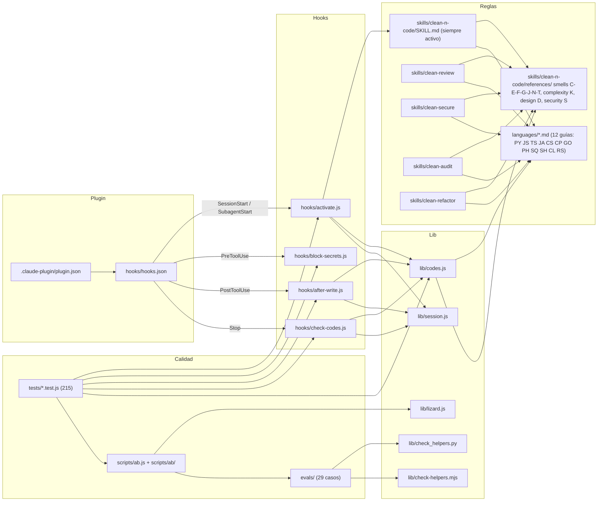

# Grafo de conocimiento: clean-n-code

Mapa de qué existe en el repositorio y cómo se conecta. Versión 1.0.0, foto del 2026-11-19 (`npm test`: 215 pasan, 0 fallan).

## Grafo

## Nodos

| Nodo | Papel | Tamaño | Lo prueba |
|---|---|---|---|
| `hooks/activate.js` | Inyecta las reglas y una tarjeta de lenguaje (la del lenguaje más usado) al iniciar sesión o subagente | 98 líneas | `tests/hook.test.js` |
| `hooks/block-secrets.js` | Bloquea escrituras con claves (AWS, GitHub, Stripe, Anthropic…) | 45 | `tests/secrets-hook.test.js` |
| `hooks/after-write.js` | Envía la tarjeta de un lenguaje la primera vez que se escribe, sin pedir rehacer el fichero | 30 | `tests/after-write.test.js` |
| `hooks/check-codes.js` | Devuelve el turno si la línea final cita códigos inexistentes | 59 | `tests/check-codes.test.js` |
| `lib/codes.js` | Códigos de reglas, lenguajes y tarjetas | 81 | `tests/codes.test.js`, `tests/catalogs.test.js` |
| `lib/session.js` | Recuerda qué tarjetas ya están en contexto | 41 | `tests/after-write.test.js` |
| `lib/lizard.js` | Métricas de complejidad para el A/B | 28 | `tests/ab.test.js` |
| `scripts/ab.js` + `scripts/ab/` | A/B sin/con plugin, juez ciego (args, judge, report aparte) | 443 + 335 | `tests/ab.test.js` |
| `skills/*/SKILL.md` | Modo siempre activo + review, secure, audit, refactor | 44–57 | `tests/skills.test.js` |
| `languages/*.md` | 12 guías de lenguaje | 34–43 | `tests/languages.test.js` |
| `evals/` | 12 lang, 9 mode/refactor, 4 review, 2 secure, 1 audit, 1 skill-refactor | 29 casos | `claude plugin eval` (`npm run eval`) |

## Coste en tokens (frente a no usar el plugin)

| | Sonnet | Haiku |
|---|---|---|
| coste | +12% | +17% |
| tokens de salida | −1% | +11% |
| escritura en caché | +21% | +21% |

## Puntos débiles conocidos

- La escritura en caché sigue un 21% por encima: es el propio conjunto de reglas.
- Refactor que descuenta stock antes de leer un precio ausente, y manejo de `ß` (fallan a veces con y sin plugin).
- `scripts/ab.js` (443 líneas) aún mezcla ejecución de brazos, escritura de resultados y resumen.
- Graders de Bash, Java y PHP por calibrar; falta verificar que `claude plugin eval` copia los `fixture/`.
